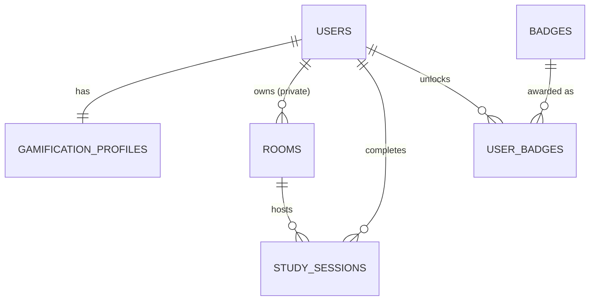

# Database — Focoya

Tài liệu này giải thích database của Focoya: có những bảng nào, mỗi cột dùng để làm gì, luật nào do DB tự chặn, luật nào backend phải tự kiểm tra, và cách thay đổi schema mà không làm hỏng dữ liệu.

| | |
|---|---|
| **DBMS** | PostgreSQL 15 (khi deploy dùng Supabase) |
| **Ai tạo bảng** | Hibernate, với `spring.jpa.hibernate.ddl-auto: update` |
| **Nguồn sự thật của schema** | Các class trong [`entity/`](../../backend/study-room-backend/src/main/java/com/lofi/studyroombackend/entity/) |
| **ERD** | [`erd.dbml`](erd.dbml): dán vào [dbdiagram.io](https://dbdiagram.io) để xem sơ đồ và xuất ảnh |

---

## 1. Bảng được tạo ra như thế nào?

Dự án **không viết SQL tạo bảng bằng tay**. Bảng được sinh ra từ các class Java:

```text
Backend khởi động
   → Hibernate đọc các class có @Entity trong package entity/
   → So với các bảng đang có trong DB
   → Bảng/cột nào CHƯA có thì tự tạo (CREATE TABLE / ALTER TABLE ADD COLUMN)
   → App sẵn sàng
```

Hệ quả:

- **Sửa entity là sửa DB.** Các thuộc tính trong annotation **thật sự tạo ràng buộc trong DB**:
  - `@Column(nullable = false)` thành `NOT NULL`
  - `@Column(length = 50)` thành `VARCHAR(50)`
  - `@Column(unique = true)` thành `UNIQUE`
- Ngoài cột, entity còn khai báo được:
  - Index: `@Table(indexes = @Index(...))`
  - Luật kiểm tra: `@Check(...)`
  - Xóa dây chuyền: `@OnDelete(action = OnDeleteAction.CASCADE)`
- Cột enum (`@Enumerated(EnumType.STRING)`): Hibernate **tự sinh** CHECK, nên chỉ những giá trị có trong enum mới lưu được.

---

## 2. Quy ước chung

| Quy ước | Ví dụ | Lý do |
|---|---|---|
| Khóa chính là **UUID**, Hibernate tự sinh | `3f2a9c1e-...` | Không đoán được ID của người khác (không dò được `/api/users/2`) |
| Tên bảng số nhiều, **snake_case** | `study_sessions`, `started_at` | Chuẩn của PostgreSQL |
| Field Java **camelCase**, nối với cột bằng `@Column(name = ...)` | `startedAt` ↔ `started_at` | Chuẩn của Java |
| Tên class entity có hậu tố **`Entity`** | `UserEntity` | Tránh trùng với class `User` của Spring Security |
| Thời gian dùng `Instant` (Java) ↔ `timestamptz` (DB), lưu theo **UTC** | `2026-10-04T15:50:00Z` | Server đặt ở đâu cũng không lệch giờ. Đổi sang giờ Việt Nam khi hiển thị |
| Enum lưu dạng **chữ** (`EnumType.STRING`) | `'IN_PROGRESS'` | Lưu dạng số (0, 1, 2) thì khi chèn thêm giá trị vào giữa enum, dữ liệu cũ bị hiểu sai |
| **Giá trị mặc định đặt trong Java** | `private int totalXp = 0;` | Hibernate INSERT luôn ghi đủ mọi cột, nên mặc định phải có sẵn trong object |
| Quan hệ `@ManyToOne` / `@OneToOne` dùng `FetchType.LAZY` | | Chỉ query bảng liên quan khi code thật sự cần |
| Entity dùng `@Getter @Setter @NoArgsConstructor`, **không dùng `@Data`** | | `@Data` sinh `toString/equals/hashCode` động vào quan hệ LAZY, gây query thừa hoặc vòng lặp vô hạn |
| Tên constraint/index có tiền tố | `chk_...`, `idx_...`, `uq_...` | Đọc thông báo lỗi là biết luật nào bị vi phạm |

---

## 3. Sơ đồ quan hệ



| Quan hệ | Loại | Cách làm |
|---|---|---|
| `users` – `gamification_profiles` | 1 – 1 | Khóa ngoại `user_id` + `UNIQUE` (bỏ `UNIQUE` thì thành 1 – n) |
| `users` – `rooms` | 1 – n | Chỉ private room có chủ (`owner_id`) |
| `users` – `study_sessions` | 1 – n | |
| `rooms` – `study_sessions` | 1 – n | |
| `users` – `badges` | n – n | Qua **bảng nối** `user_badges` |

---

## 4. Chi tiết từng bảng

Ký hiệu cột "Bắt buộc": ✅ là `NOT NULL`, để trống là cho phép `NULL`.

### 4.1 `users`: tài khoản và profile cơ bản

- **Entity:** [`UserEntity`](../../backend/study-room-backend/src/main/java/com/lofi/studyroombackend/entity/UserEntity.java)


Tên bảng là `users` (số nhiều) vì `user` là **từ khóa** của PostgreSQL.

| Cột | Kiểu | Bắt buộc | Ý nghĩa |
|---|---|---|---|
| `id` | uuid | ✅ | Khóa chính |
| `email` | varchar(255) | ✅ | Dùng để đăng nhập. **UNIQUE**: đăng ký trùng thì trả HTTP 409 |
| `password_hash` | varchar(255) | ✅ | Mật khẩu đã băm bằng BCrypt. **Không bao giờ** lưu mật khẩu thật, **không bao giờ** trả ra API |
| `display_name` | varchar(50) | ✅ | Tên hiển thị trong phòng học (2 – 50 ký tự, validate ở DTO) |
| `avatar_key` | varchar(50) | | Mã avatar có sẵn phía frontend (vd `cat-01`), không phải link ảnh |
| `bio` | varchar(200) | | Giới thiệu ngắn |
| `role` | varchar(20) | ✅ | `USER` (mặc định) hoặc `ADMIN`. Đưa vào JWT |
| `created_at`, `updated_at` | timestamptz | ✅ | Hibernate tự điền (`@CreationTimestamp`, `@UpdateTimestamp`) |

### 4.2 `gamification_profiles`: XP, streak, mục tiêu ngày

- **Entity:** [`GamificationProfileEntity`](../../backend/study-room-backend/src/main/java/com/lofi/studyroombackend/entity/GamificationProfileEntity.java)


Mỗi user có **đúng 1** profile. Backend phải tạo profile **ngay khi user đăng ký** (TSK-06).

> **Level KHÔNG lưu.** Level được tính từ `total_xp` mỗi khi cần, theo công thức `floor(sqrt(total_xp / 100)) + 1` (Excel TSK-25). Lưu cả hai thì sớm muộn sẽ lệch nhau.

| Cột | Kiểu | Bắt buộc | Ý nghĩa |
|---|---|---|---|
| `id` | uuid | ✅ | Khóa chính |
| `user_id` | uuid | ✅ | FK → `users`, **UNIQUE** (1 – 1). Xóa user thì profile tự bị xóa (CASCADE) |
| `total_xp` | int | ✅ | Tổng XP, mặc định 0, **≥ 0**. Chỉ backend được cộng XP |
| `current_streak` | int | ✅ | Số ngày học liên tiếp hiện tại, **≥ 0** |
| `longest_streak` | int | ✅ | Kỷ lục streak, **≥ 0** |
| `last_study_date` | date | | Ngày học gần nhất (chỉ ngày, không giờ). Dùng để tính streak |
| `daily_goal_minutes` | int | ✅ | Mục tiêu phút/ngày, mặc định 60 (đạt thì +50 XP, Excel TSK-25) |
| `updated_at` | timestamptz | ✅ | Hibernate tự điền |

### 4.3 `rooms`: phòng học ảo

- **Entity:** [`RoomEntity`](../../backend/study-room-backend/src/main/java/com/lofi/studyroombackend/entity/RoomEntity.java)
- **Phụ trách:** Thọ (TSK-12)

| Loại | Ai tạo | `owner_id` | `invite_code` | Ai vào được |
|---|---|---|---|---|
| `PUBLIC` | `DataSeeder` seed sẵn 6 phòng (theo mock của FE) | `NULL` | `NULL` | Mọi người, kể cả khách chưa đăng nhập |
| `PRIVATE` | User tự tạo | **Bắt buộc** | **Bắt buộc**, 6 ký tự | Người có mã mời |

**Xóa mềm:** không xóa dòng, chỉ đặt `is_active = false`. Lý do: các `study_sessions` cũ vẫn trỏ tới phòng này; xóa thật sẽ lỗi khóa ngoại và mất lịch sử học.

**Số người đang online** trong phòng không lưu ở đây, mà lấy từ bộ nhớ của backend (xem mục 5).

| Cột | Kiểu | Bắt buộc | Ý nghĩa |
|---|---|---|---|
| `id` | uuid | ✅ | Khóa chính |
| `owner_id` | uuid | | FK → `users`. `NULL` với public room |
| `name` | varchar(100) | ✅ | Tên phòng |
| `description` | text | | Mô tả, không giới hạn độ dài |
| `theme_key` | varchar(50) | ✅ | Tên theme đúng như FE hiển thị: `Study`, `Café`, `Nature`, `Gaming`, `Chill`. API trả ra với tên field `theme` |
| `scene_key` | varchar(50) | | Đường dẫn ảnh nền có sẵn trong FE, vd `/room-assets/rainy.jpg`. API trả ra với tên field `image` |
| `ambient_track_key` | varchar(50) | | Mã âm thanh nền (mưa, lửa trại...) |
| `visibility` | varchar(10) | ✅ | `PUBLIC` hoặc `PRIVATE` |
| `invite_code` | varchar(6) | | Mã mời, **UNIQUE**. PostgreSQL cho phép nhiều dòng cùng `NULL`, nên public room không bị lỗi trùng |
| `max_slots` | int | ✅ | Số người tối đa, **> 0** |
| `is_active` | boolean | ✅ | `false` = đã xóa mềm. Mặc định `true` |
| `created_at`, `updated_at` | timestamptz | ✅ | Hibernate tự điền |

Luật DB tự chặn:
- `chk_rooms_private_fields`: `PRIVATE` thì bắt buộc có `owner_id` **và** `invite_code`; `PUBLIC` thì **không được** có `invite_code`.
- `chk_rooms_max_slots`: `max_slots > 0`.

Index: `idx_rooms_owner_id`, dùng để tìm các phòng do một user tạo.

### 4.4 `study_sessions`: mỗi lần học (1 Pomodoro) là 1 dòng

- **Entity:** [`StudySessionEntity`](../../backend/study-room-backend/src/main/java/com/lofi/studyroombackend/entity/StudySessionEntity.java)
- **Phụ trách:** Thọ ghi (TSK-20); Tiên đọc để làm history, dashboard, leaderboard (TSK-23, TSK-27)

**Vòng đời một session** (Excel TSK-20):

```text
POST /api/study-sessions/start
   → tạo dòng mới: status = IN_PROGRESS, started_at = GIỜ SERVER

POST /api/study-sessions/finish
   → ended_at = giờ server
   → duration_minutes = ended_at - started_at       (server tự tính)
   → đủ tối thiểu 5 phút:  status = COMPLETED, xp_earned = server tự tính
   → không hợp lệ / bỏ dở: status = CANCELLED, xp_earned = 0
```

> **Chống gian lận:** client **không gửi** thời lượng hay XP. Mọi thời gian đều lấy theo đồng hồ server.

| Cột | Kiểu | Bắt buộc | Ý nghĩa |
|---|---|---|---|
| `id` | uuid | ✅ | Khóa chính |
| `user_id` | uuid | ✅ | FK → `users`. Xóa user thì xóa luôn lịch sử học (CASCADE) |
| `room_id` | uuid | ✅ | FK → `rooms`. Không CASCADE vì room chỉ xóa mềm |
| `status` | varchar(20) | ✅ | `IN_PROGRESS` / `COMPLETED` / `CANCELLED` |
| `started_at` | timestamptz | ✅ | Lúc bấm start (giờ server) |
| `ended_at` | timestamptz | | Lúc kết thúc. `NULL` khi đang chạy |
| `duration_minutes` | int | | Số phút học thực tế. `NULL` khi chưa kết thúc |
| `xp_earned` | int | ✅ | XP nhận được (1 phút = 1 XP). Lưu theo từng session để leaderboard tuần tính bằng `SUM(xp_earned)` |
| `created_at` | timestamptz | ✅ | Hibernate tự điền |

Luật DB tự chặn:
- `chk_ss_ended`: `ended_at` không được trước `started_at`.
- `chk_ss_xp`: `xp_earned ≥ 0`.
- `chk_ss_duration`: `duration_minutes ≥ 0` (hoặc `NULL`).

Index (đặt theo đúng các câu truy vấn sẽ dùng nhiều nhất):

| Index | Dùng cho |
|---|---|
| `idx_ss_user_started (user_id, started_at)` | Lịch sử học, dashboard: "session của user X từ ngày A tới ngày B" |
| `idx_ss_room_id (room_id)` | Thống kê theo phòng (phòng học yêu thích) |
| `idx_ss_status_ended (status, ended_at)` | Leaderboard tuần: "session COMPLETED kết thúc trong tuần này" |

### 4.5 `badges`: danh mục huy hiệu

- **Entity:** [`BadgeEntity`](../../backend/study-room-backend/src/main/java/com/lofi/studyroombackend/entity/BadgeEntity.java)
- **Phụ trách:** Tiên (TSK-26). Bảng đã có sẵn; dữ liệu seed thêm sau

| Cột | Kiểu | Bắt buộc | Ý nghĩa |
|---|---|---|---|
| `id` | uuid | ✅ | Khóa chính |
| `code` | varchar(50) | ✅ | Mã cố định để code tra cứu, **UNIQUE** (vd `FIRST_STEP`, `ON_FIRE`) |
| `name` | varchar(100) | ✅ | Tên hiển thị (vd `First Step`) |
| `description` | varchar(255) | | Mô tả |
| `icon_key` | varchar(50) | | Mã icon phía frontend |
| `condition_type` | varchar(50) | ✅ | Loại điều kiện mở khóa (vd `TOTAL_SESSIONS`, `STREAK_DAYS`) |
| `condition_value` | int | ✅ | Ngưỡng. Ví dụ: (`STREAK_DAYS`, 7) nghĩa là học 7 ngày liên tiếp |

### 4.6 `user_badges`: user nào đã mở khóa badge nào

- **Entity:** [`UserBadgeEntity`](../../backend/study-room-backend/src/main/java/com/lofi/studyroombackend/entity/UserBadgeEntity.java)
- **Phụ trách:** Tiên (TSK-26)

Đây là **bảng nối** cho quan hệ n – n: một user có nhiều badge, một badge thuộc về nhiều user.

| Cột | Kiểu | Bắt buộc | Ý nghĩa |
|---|---|---|---|
| `id` | uuid | ✅ | Khóa chính |
| `user_id` | uuid | ✅ | FK → `users` (CASCADE) |
| `badge_id` | uuid | ✅ | FK → `badges` (CASCADE) |
| `unlocked_at` | timestamptz | ✅ | Thời điểm mở khóa, Hibernate tự điền |

Luật DB tự chặn: `uq_user_badges_user_badge UNIQUE (user_id, badge_id)`. Mỗi cặp user–badge chỉ có một dòng, nên dù code trao badge lỡ chạy hai lần thì user cũng không nhận trùng (**idempotent**).

---

## 5. Thứ KHÔNG lưu trong DB

**Presence**: ai đang online trong phòng nào, đang `STUDYING` / `BREAK` / `IDLE`. Dữ liệu này nằm trong **bộ nhớ của backend** (PresenceRegistry, TSK-16), không ghi vào DB, vì:
- nó thay đổi liên tục (mỗi lần join, leave, đổi trạng thái);
- restart server mà mất cũng không sao, client sẽ kết nối lại và join lại.

---

## 6. Luật DB KHÔNG chặn: backend phải tự kiểm tra

Những luật dưới đây **không có ràng buộc nào trong DB**. Nếu service quên kiểm tra thì dữ liệu sai vẫn lưu vào được.

| Luật | Kiểm tra ở đâu |
|---|---|
| Mỗi user chỉ có **tối đa 1 session `IN_PROGRESS`** (chống bấm Start 2 lần) | `StudySession` service, khi start (TSK-20) |
| Session phải **≥ 5 phút** mới được tính XP | Service, khi finish (TSK-20) |
| `xp_earned`, `total_xp` **chỉ do server tính** | Service, không nhận XP từ request |
| Private room có **10 – 30 slots** | Room service, khi tạo (TSK-12) |
| Mỗi user **tối đa 2 private room đang active** | Room service, khi tạo (TSK-12) |
| `invite_code` sinh ngẫu nhiên 6 ký tự, không trùng | Room service; DB có `UNIQUE` chặn trùng ở lớp cuối |
| Phòng **đầy** (đủ `max_slots` người online) thì không cho vào | Join room, đếm từ PresenceRegistry |
| **Seed không bị trùng** khi restart (4 public room, các badge) | DataSeeder phải kiểm tra "đã có chưa" trước khi thêm (TSK-12, TSK-26) |
| Tạo `gamification_profiles` ngay khi đăng ký | Auth service, khi register (TSK-06) |

---

## 7. Muốn thay đổi schema thì làm thế nào?

1. Sửa entity Java: thêm field, sửa `@Column`, thêm `@Index` hoặc `@Check`.
2. Chạy backend. Hibernate tự **thêm** bảng/cột còn thiếu.
3. Cập nhật `erd.dbml` và file này.
4. Ghi rõ thay đổi trong mô tả PR để mọi người biết.

### ⚠️ Giới hạn của `ddl-auto: update`, đọc kỹ trước khi sửa

`update` **chỉ THÊM**, **không xóa** và **không đổi tên**:

| Bạn làm | Hibernate làm | Hậu quả |
|---|---|---|
| Thêm field mới | Thêm cột mới | ✅ OK |
| **Đổi tên** field (vd `bio` → `about`) | Tạo cột `about` **mới, rỗng** | ❌ Cột `bio` cùng dữ liệu cũ vẫn nằm lại, app không đọc nữa |
| **Xóa** field | Không làm gì | Cột vẫn còn trong DB |
| Đổi `length`, kiểu dữ liệu | Không làm gì | DB vẫn giữ kiểu cũ |
| Thêm `nullable = false` hoặc `@Check` cho **bảng đã có** | Không làm gì | Ràng buộc mới **không** được áp dụng |
| Thêm field `nullable = false` vào bảng **đã có dữ liệu** | Thử thêm cột `NOT NULL`, PostgreSQL từ chối (dòng cũ không có giá trị) | ❌ **App vẫn khởi động bình thường**, lỗi chỉ hiện trong log (`contains null values`). Cột **không được tạo**, tới lúc code đọc/ghi cột đó mới lỗi |

Gặp các trường hợp ❌ hoặc "không làm gì":
- **Ở máy mình:** xóa sạch DB rồi chạy lại backend để Hibernate tạo lại từ đầu.
- **Trên DB đã deploy (Supabase, có dữ liệu thật):** phải sửa tay bằng SQL. **Hỏi Thọ trước khi làm.**

---
